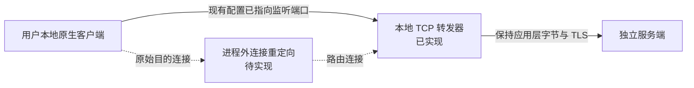

# 原生客户端不改写条件下的启动与连接设计

## 交付与发布边界

仅发布服务端和独立 Rust 启动器。用户自行提供本地客户端及游戏资源，启动器不下载、不打包、不复制它们，也不提供游戏资源更新。

启动器不替换 EXE/DLL，不注入、不写进程内存，不改写 `dwauth.ini`、`stun.ini`、`iips.ini`、`cacert.pem` 或游戏资源。配置、锁和日志位于客户端目录之外。Rust 原生窗口使用 egui/eframe，TCP 转发及进程管理使用 Tokio。

v0 已实现：窗口与 CLI、只读文件检查、已有连接配置匹配检查、固定上游 TCP 转发、原生进程启动及会话清理。没有实现 WFP/WinDivert、DNS/hosts 修改、UDP NAT 或 TLS 代理；`external` 模式明确阻止客户端启动。

用户可在窗口指定服务器 IP/域名与 AUTH、LOBBY 端口，保存启动器自己的联机配置；CLI 提供 `--server`、`--auth-port`、`--lobby-port`。域名在每个新连接时解析为 IP，支持 IPv4/IPv6；解析有超时并检查转发循环。客户端原有连接目标及 TLS 主机名不随上游选择改变。

面向玩家的完整联机还要求服务端绑定可达地址、认证证书满足原客户端验证、STUN 的观测地址正确，以及分配给玩家的游戏 UDP 地址可达。原型只实现地址选择与 TCP 转发，不把这些未完成的条件当成已经验证的公网联机能力。

## 样本证据

以下仅针对本机 3.3.3.3 研究样本，不适用于所有客户端版本。

| 已观察行为 | 证据 | 影响 |
| --- | --- | --- |
| `dwauth.ini` 含五个字段；A 为大厅，B 为 HTTPS AUTH | 服务端 `docs/BOOTSTRAP_FINDINGS.md`、`GAMEHUB_DEBUG.md`、`AUTH_LOBBY_PROGRESS.md` | 可只读匹配原有配置；尚未验证命令行覆盖端点的接口 |
| 旧工具写入连接配置，并可临时附加实验 CA | 服务端 `tools/gamehub_run.py` | 不调用旧工具作为启动器后端 |
| curl 读取相对路径 `cacert.pem`，工作目录改变时可能读取 `IIPS/cacert.pem` | 服务端 `docs/AUTH_LOBBY_PROGRESS.md` | 系统信任库并非已证明有效的替代入口 |
| 存在 UDP/STUN 3074/3078 与独立游戏通道 | 服务端 `docs/AUTH_LOBBY_PROGRESS.md`、`GAME_TRANSPORT_PROGRESS.md` | 只转发 AUTH/LOBBY 的 TCP 不足以覆盖完整连接 |

本机 `CODOL` 是旧研究副本的链接，已有本地地址及实验 CA。新启动器没有改动它；在此副本上通过检查，不能证明官方发行包无需任何配置变更就能登录。

## Windows WFP 拦截适配器

Microsoft [Using Bind or Connect Redirection](https://learn.microsoft.com/en-us/windows-hardware/drivers/network/using-bind-or-connect-redirection) 说明，WFP 的 ALE callout 驱动可把连接重定向至代理。因此客户端进程外的连接重定向在技术上可行，但需要驱动及配套代理实现。

拟议规则限定已核对的程序路径、进程创建时间、协议及原目的地址/端口；排除代理自己的出站连接，防止循环。代理需查询和传递 WFP redirect records，并保存原目的端点上下文。当前 Rust TCP 转发器没有实现这些 Windows IOCTL，不能直接用作已完成的 WFP 代理。

目标平台先限定 Windows 10/11 x64。驱动需要 WDK、符合系统要求的签名及管理员安装；驱动与服务独立于游戏目录部署。启动器通过有访问控制的本机 IPC 管理会话规则，避免仅依靠可能复用的 PID。首包在规则接入前逃逸的竞态、进程子组件识别与 UDP 源地址语义都须验证。

| 拟议 IPC | 数据与作用 |
| --- | --- |
| `prepare` | 程序路径、摘要、允许的原目的端点、转发端口、会话 ID |
| `attach` | 新启动进程身份及创建时间，与程序和会话核对 |
| `heartbeat` | 续租；控制端失联后自动回收规则 |
| `status` | 规则句柄、命中计数及错误，不含应用载荷 |
| `release` | 撤销指定会话规则，不清空系统全部规则 |

这是接口草案，不是当前 CLI 功能。上线前必须验证正常退出、启动失败、控制端崩溃和重启后的回收；原型不会自动安装驱动或修改系统网络。

## 其他路由方案的限制

| 方案 | 限制 |
| --- | --- |
| DNS / hosts | 只影响域名解析，不改变端口，对硬编码 IP 无效，可能影响其他程序 |
| HTTP / SOCKS 代理 | 需要客户端本身支持；尚无证据证明游戏通道读取系统代理 |
| TCP 固定转发 | 连接必须实际到达监听端口；本身不拦截原始目的连接 |
| WinDivert | 可作为候选；需审查许可、身份关联、地址回写、校验和及回环行为，v0 未接入 |
| 专属虚拟机网络 NAT | 可另行研究；Wine prefix 本身不是网络命名空间 |

普通转发会改变服务端观察到的源地址，STUN/UDP 的处理不能简单照搬 TCP。v0 不默认修改全局 hosts、代理、信任库或防火墙。

## TLS 与完整接入的阻塞

路由只决定字节去哪里，客户端仍按原有主机名、CA bundle、协议版本及可能的固定策略校验证书。改 IP 或端口不产生受信任身份；不信任自签名证书、CA 文件缺失或固定官方主机名的情形，无法单靠请求转向解决。

若客户端提供可用的原生端点配置接口，且能指向我们控制的域名，才可研究由现有 CA 信任的证书。当前样本没有验证到不改写文件的端点/CA 覆盖接口，认证路径还涉及旧 TLS，不能假设现代证书直接可用。

本次排除改写 CA、关闭验证、函数 hook、证书固定绕过及使用官方私钥。若现有接口不能满足认证，应明确报告约束无法同时满足，不能暗中突破“不修改客户端”的边界。

## 用户提出的替代方向：重写客户端

独立实现渲染、输入、UI、音频和网络协议，允许用户从本地安装导入可使用的资源，可避免原客户端固定连接与证书路径的限制。这是另一条路线，本次仍按用户确认的范围只交付服务端及启动器，没有开始实现游戏引擎。

若后续采用该路线，应先用自制场景验证客户端，再独立形成资源格式规格和读取接口。代码原创与资源授权分别核查；读取用户本地文件可减少资源分发，却不自动取得使用、改编、公开展示或运营许可。公开构建和演示应能使用自制或有明确授权的资源完成。不得移入原客户端实现、反编译代码、专有脚本或字节码，也不以资源导入为理由绕过技术保护。

## 验收范围

自动测试使用本项目自己的合成程序及本机 TCP 服务，覆盖摘要检查、目录隔离、双向大数据、半关闭、上游失败、端口冲突、活动连接停止及会话锁。检查不启动真实游戏，也不需要原游戏资源。

完整原生接入仍需：建立官方发行包来源基线；接入前后核对 EXE/DLL/配置/CA/资源；验证 Windows 首次连接、认证、大厅、STUN 和游戏 UDP；确认其他进程不受影响；测试规则异常回收。目前没有这些实机验收结论。
