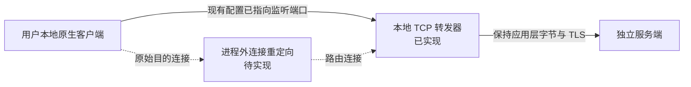

# 原生客户端接入与本地启动设计

## 交付与发布边界

仅发布服务端和独立 Rust 启动器。用户自行提供本地客户端及游戏资源，启动器不下载、不打包、不复制它们，也不提供游戏资源更新。

启动器不替换 EXE/DLL，不注入、不写进程内存，不改写游戏资源。本机原生模式允许临时调整 `dwauth.ini`、`stun.ini`、`iips.ini` 和两个 `cacert.pem`，会话结束恢复。配置、备份、记录和日志位于客户端目录之外。Rust 原生窗口使用 egui/eframe，进程管理与 TCP 转发使用 Tokio。

已实现：本机原生配置生成、只读检查、本地服务端管理、就绪等待、原生进程识别、临时配置、恢复与占用保护；原有固定上游 TCP 转发仍可使用。没有实现 WFP/WinDivert、DNS/hosts 修改、UDP NAT 或 TLS 代理；转发模式的 `external` 仍阻止客户端启动。

## 本地原生流程

备份和恢复记录实际在服务启动前落盘，客户端文件在就绪之后才修改。就绪读取两个本次进程原子发布的JSON记录，核对版本、PID、客户端基线、协议、实际端点和玩法装配；不创建额外 AUTH 探测会话。服务端须支持 `--launcher-ready-file`，普通日志不作为就绪接口。启动、地图加载及原生进程出现都有有界超时。接口见 [SERVER_INTERFACE.md](SERVER_INTERFACE.md)。

原生程序由用户自行提供，直接调用其参数入口。在 Windows 上启动 EXE；Wine 可配置现有运行器及 prefix。启动器检查实际游戏进程而非仅追踪 `start.exe` 包装器，正常包装器退出后仍有界等待真实游戏出现；进程身份包含路径、PID 和创建时间。

跨配置目录的外部锁与已有研究工具锁用于避免同一客户端配置被并发修改。只结束本次记录的进程，不按名称批量清理其他 Wine 程序，不执行全局 `wineserver -k`。已有游戏会话在启动前被拒绝。

macOS 另持有 prefix 级独占锁。Wine 通信目录按 prefix 的设备号和 inode 定位，使用记录锁查询实际持有者；只有同用户、RSS 为零且处于系统退出状态的旧 wineserver 才可隔离。隔离保留原目录，并重新执行有界基础检查。匹配项目标记和 Wine 安装身份的专用 prefix 支持关闭本次 wineserver，关闭前复核锁持有者、程序路径及创建时间。其它 prefix 不执行整体关闭。详细限制见 [WINE_RECOVERY.md](WINE_RECOVERY.md)。

客户端 stdout/stderr 持续排空，共用最多 4 MiB 的 `client.log`，达到上限后从头记录。`trace_wine_files` 默认关闭，诊断时可临时开启文件访问跟踪；管理命令、强制终止后的等待及日志读取任务均有明确退出路径。

恢复记录覆盖明确的五个配置/CA 路径。原始内容和预期修改摘要在写入前保存；不存在的文件也记录其缺失状态。每次恢复验证备份摘要、允许路径以及当前文件是否仍为原始内容或本次修改；外部修改产生冲突时不覆盖。写入和记录通过临时文件替换，Unix 上同步文件及父目录。

正常结束自动恢复；异常后可通过 `native-recover` 根据记录回收自有进程再恢复。不能保证进程被 SIGKILL 时立即执行清理，恢复命令也不会抢占仍运行的原启动器。异常发生在尚未捕获分离式原生进程身份时，会保留配置并要求先退出该客户端。

用户可在窗口指定服务器 IP/域名与 AUTH、LOBBY 端口，保存启动器自己的联机配置；CLI 提供 `--server`、`--auth-port`、`--lobby-port`。域名在每个新连接时解析为 IP，支持 IPv4/IPv6；解析有超时并检查转发循环。客户端原有连接目标及 TLS 主机名不随上游选择改变。

面向玩家的完整联机还要求服务端绑定可达地址、认证证书满足原客户端验证、STUN 的观测地址正确，以及分配给玩家的游戏 UDP 地址可达。原型只实现地址选择与 TCP 转发，不把这些未完成的条件当成已经验证的公网联机能力。

## 样本证据

以下仅针对本机 3.3.3.3 研究样本，不适用于所有客户端版本。

| 已观察行为 | 证据 | 影响 |
| --- | --- | --- |
| `dwauth.ini` 含五个字段；A 为大厅，B 为 HTTPS AUTH | 服务端 `docs/BOOTSTRAP_FINDINGS.md`、`GAMEHUB_DEBUG.md`、`AUTH_LOBBY_PROGRESS.md` | 可只读匹配原有配置；尚未验证命令行覆盖端点的接口 |
| 本地研究路径使用连接 INI 和临时实验 CA | 服务端 `tools/gamehub_run.py` | 按已允许的边界在 Rust 内实现事务管理，不调用 Python 工具 |
| curl 读取相对路径 `cacert.pem`，工作目录改变时可能读取 `IIPS/cacert.pem` | 服务端 `docs/AUTH_LOBBY_PROGRESS.md` | 系统信任库并非已证明有效的替代入口 |
| 存在 UDP/STUN 3074/3078 与独立游戏通道 | 服务端 `docs/AUTH_LOBBY_PROGRESS.md`、`GAME_TRANSPORT_PROGRESS.md` | 只转发 AUTH/LOBBY 的 TCP 不足以覆盖完整连接 |

本机 `CODOL` 是旧研究副本的链接，已有本地地址及实验 CA。新启动器没有改动它；在此副本上通过检查，不能证明官方发行包无需任何配置变更就能登录。

## Windows WFP 拦截适配器

Microsoft [Using Bind or Connect Redirection](https://learn.microsoft.com/en-us/windows-hardware/drivers/network/using-bind-or-connect-redirection) 说明，WFP 的 ALE callout 驱动可把连接重定向至代理。因此客户端进程外的连接重定向在技术上可行，但需要驱动及配套代理实现。

拟议规则限定已核对的程序路径、进程创建时间、协议及原目的地址/端口；排除代理自己的出站连接，防止循环。代理需查询和传递 WFP redirect records，并保存原目的端点上下文。当前 Rust TCP 转发器没有实现这些 Windows IOCTL，不能直接用作已完成的 WFP 代理。

目标平台先限定 Windows 10/11 x64。驱动需要 WDK、符合系统要求的签名及管理员安装；驱动与服务独立于游戏目录部署。启动器通过有访问控制的本机 IPC 管理会话规则，避免仅依靠可能复用的 PID。首包在规则接入前逃逸的竞态、进程子组件识别与 UDP 源地址语义都须验证。

| 拟议 IPC | 数据与作用 |
| --- | --- |
| `prepare` | 程序路径、摘要、允许的原目的端点、转发端口、会话 ID |
| `attach` | 新启动进程身份及创建时间，与程序和会话核对 |
| `heartbeat` | 续租；控制端失联后自动回收规则 |
| `status` | 规则句柄、命中计数及错误，不含应用载荷 |
| `release` | 撤销指定会话规则，不清空系统全部规则 |

这是接口草案，不是当前 CLI 功能。上线前必须验证正常退出、启动失败、控制端崩溃和重启后的回收；原型不会自动安装驱动或修改系统网络。

## 其他路由方案的限制

| 方案 | 限制 |
| --- | --- |
| DNS / hosts | 只影响域名解析，不改变端口，对硬编码 IP 无效，可能影响其他程序 |
| HTTP / SOCKS 代理 | 需要客户端本身支持；尚无证据证明游戏通道读取系统代理 |
| TCP 固定转发 | 连接必须实际到达监听端口；本身不拦截原始目的连接 |
| WinDivert | 可作为候选；需审查许可、身份关联、地址回写、校验和及回环行为，v0 未接入 |
| 专属虚拟机网络 NAT | 可另行研究；Wine prefix 本身不是网络命名空间 |

普通转发会改变服务端观察到的源地址，STUN/UDP 的处理不能简单照搬 TCP。v0 不默认修改全局 hosts、代理、信任库或防火墙。

## TLS 与完整接入的阻塞

路由只决定字节去哪里，客户端仍按原有主机名、CA bundle、协议版本及可能的固定策略校验证书。改 IP 或端口不产生受信任身份；不信任自签名证书、CA 文件缺失或固定官方主机名的情形，无法单靠请求转向解决。

若客户端提供可用的原生端点配置接口，且能指向我们控制的域名，才可研究由现有 CA 信任的证书。当前样本没有验证到不改写文件的端点/CA 覆盖接口，认证路径还涉及旧 TLS，不能假设现代证书直接可用。

本地原生模式仅附加配置中指定的自有本地证书，保留原有信任根并恢复原文件；这允许原客户端按自己的机制验证本地 TLS。关闭验证、函数 hook、证书固定绕过及使用官方私钥不在实现范围内。远端转发仅选择上游，仍不能自动满足原 TLS 主机名和身份验证条件。

## 客户端与资源

本项目通过原生客户端使用画面、资源和玩法，只实现启动器及独立服务端，不实现替代游戏引擎。用户本地持有资源不等于项目获得分发授权；客户端和资源不会进入仓库、测试包或发行包。

## 验收范围

自动测试使用合成程序及本机 TCP/UDP 服务，覆盖摘要、目录隔离、原生占用、服务提前退出、未就绪、取消、临时 CA、缺失文件恢复、部分写入恢复、外部冲突及符号链接保护；转发测试继续覆盖双向大数据、半关闭与连接清理。不需要原游戏资源。

本机 macOS/Wine10 样本已通过原生认证、大厅、开房、阿富汗地图进入、移动、射击、换弹和结算；会话结束验证受检文件摘要及临时配置恢复。检查范围不是全资源清单。Windows、公网联机、所有地图和客户端版本尚未验收，官方发行包来源和资源授权仍需独立核实。
